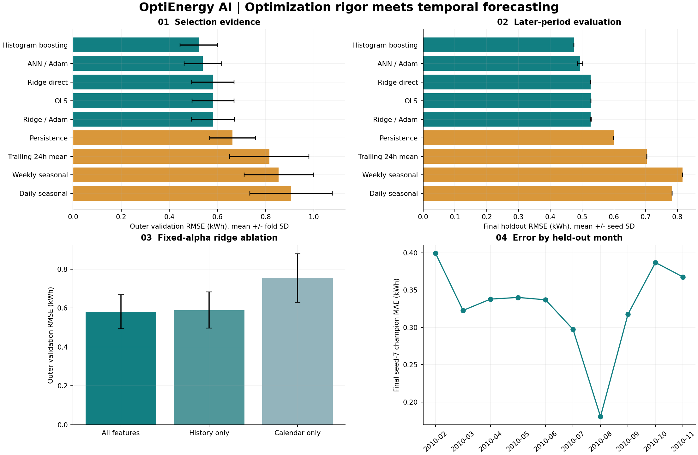
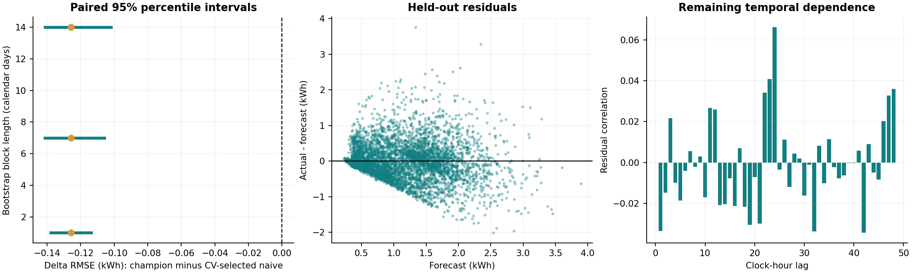
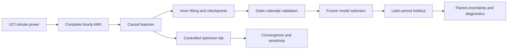

# OptiEnergy AI

**A notebook-first study of optimization dynamics and next-hour household energy forecasting.**

Hand-written NumPy optimizers, a PyTorch neural network, explicit computation budgets, temporal model selection, strong reference baselines, and measured uncertainty. The project runs on a CPU without paid APIs. The primary deliverable is [the executed notebook](OptiEnergy_AI.ipynb); no project archive is needed.



## Measured result

Cross-validation selected **Histogram boosting**. On **6,296** comparable forecasts from **2010-02-13 02:00:00 to 2010-11-26 21:00:00**, its RMSE was **0.4738 kWh**, versus **0.5995 kWh** for the validation-selected naive reference, **Persistence**: **20.98% lower RMSE**.

For the fixed deployment seed 7, a paired seven-calendar-day moving-block bootstrap gave a delta-RMSE interval of **[-0.1412, -0.1059] kWh** (approximate 95% percentile interval; negative favors the selected model). One- and fourteen-day sensitivity intervals are also exported. This describes one held-out household period and is not a calibrated per-forecast interval or a population guarantee.

Every number above is derived from the committed [evidence tables](results/temporal/forecasting_leaderboard.csv). Family selection uses outer validation, never the final test scores.

## Two studies, two questions

| Study | Purpose | Executed scope |
|---|---|---|
| Optimization lab | Compare update rules under paired within-family conditions | Eight optimizers, linear/ridge/ANN, three seeds, 126 attempted runs, first 2,400 clock hours |
| Temporal forecasting benchmark | Evaluate model families across later periods | Three calendar validation folds; distinct inner checkpoints; 69 candidate-fold-seed scores; 13 final scores; 9 ablations |

The optimizer lab includes Batch GD, SGD, mini-batch GD, Momentum, Nesterov, RMSprop, Adam, and L-BFGS. The first-order linear/ridge implementations are written from scratch and checked numerically. L-BFGS counts every full-data closure, including line-search work. Loss curves expose data passes, updates, gradients, time and monitoring overhead. Divergence is retained in the logs.

The forecasting benchmark compares persistence, daily seasonal, weekly seasonal, trailing mean, OLS, direct ridge, custom ridge/Adam, ANN/Adam, and histogram gradient boosting. These model families have different tuning/training procedures. Their scores are **not** a controlled optimizer ranking. The larger full multi-year optimizer sensitivity grid is implemented but not pre-executed.

## Final benchmark table

All errors below are in kWh. Rows are ordered by cross-validation RMSE. Fold variation and seed variation are reported separately in the full CSV; direct/single fixed-seed references have no estimated seed SD.

| Family | Outer CV RMSE | Final RMSE | Final MAE | Stochastic seed SD |
|---|---:|---:|---:|---:|
| Histogram boosting | 0.5222 | 0.4738 | 0.3296 | single fixed-seed / direct |
| ANN / Adam | 0.5390 | 0.4937 | 0.3448 | 0.0081 |
| Ridge direct | 0.5811 | 0.5270 | 0.3755 | single fixed-seed / direct |
| OLS | 0.5813 | 0.5273 | 0.3755 | single fixed-seed / direct |
| Ridge / Adam | 0.5813 | 0.5273 | 0.3766 | 0.0011 |
| Persistence | 0.6623 | 0.5995 | 0.3933 | single fixed-seed / direct |
| Trailing 24h mean | 0.8149 | 0.7041 | 0.5543 | single fixed-seed / direct |
| Weekly seasonal | 0.8537 | 0.8155 | 0.5631 | single fixed-seed / direct |
| Daily seasonal | 0.9054 | 0.7830 | 0.5274 | single fixed-seed / direct |

The optimizer lab's early-window selection and the forecasting benchmark's selection are separate. A better observed test score never overrides a validation decision. Read [the findings](docs/FINDINGS.md), [model card](docs/MODEL_CARD.md), and [data card](docs/DATA_CARD.md) for scope and limitations.

## What to inspect

* **Mathematics:** analytic MSE/L2 gradients, a Hessian spectrum, numerical rank, and the stable batch-GD step bound.
* **Implementation:** reusable NumPy update classes, PyTorch training, validation-best checkpoints, explicit counters, and graceful divergence handling.
* **Temporal validity:** calendar-based outer windows, inner checkpoint periods, 24-hour embargoes, and train-only scaling.
* **Baselines:** the correct daily/weekly next-hour alignment and a boosted-tree reference with random internal early stopping disabled.
* **Interpretation:** fixed-alpha feature ablations on identical rows, residual correlation, monthly/hourly/weekday error slices, and paired temporal resampling.
* **Verification:** 40 core tests plus 12 temporal/uncertainty tests inside the notebook, repository checks, and a separate CI execution profile.



## Run it

Open **OptiEnergy_AI.ipynb** in Google Colab, JupyterLab or VS Code and run cells in order. The first cell installs only missing/incompatible dependencies. Data downloads automatically from UCI and is cached. There is no dataset/project upload step.

For a local environment, use Python 3.11-3.13:

```bash
python -m venv .venv
```

Windows PowerShell:

```powershell
.\.venv\Scripts\python.exe -m pip install -r requirements.txt
```

macOS/Linux:

```bash
source .venv/bin/activate
python -m pip install -r requirements.txt
```

Select that environment as the notebook kernel in VS Code. For a browser-based local JupyterLab session, additionally install `jupyterlab` and run `jupyter lab`. First use requires internet for dependencies and the public dataset. All fitted models and tensors use the CPU. Exact tested package versions are in [requirements-tested.txt](requirements-tested.txt).

Programmatic checks:

```bash
python -m unittest discover -s tests -v
python tools/run_notebook.py --profile ci --output work/ci-executed.ipynb
```

The CI profile reduces seeds/epochs and caps training/evaluation rows. It checks execution, not research accuracy, and its results cannot replace the portfolio evidence. The included GitHub Actions workflow executes this profile after upload; inspect the repository's Actions page for hosted run status.

Optimizer-lab cache hits retain the original measured fit times; inspect `cache_hit` in runs.csv and the run manifest. Set `USE_TRAINING_CACHE=False` in the notebook to remeasure them. The later-period forecasting benchmark executes fresh fits on each run. Wall time still varies with hardware and process load.

Regenerate the full default portfolio evidence:

```bash
python tools/run_notebook.py --profile portfolio --output OptiEnergy_AI.ipynb
python tools/refresh_evidence.py
```

Set the optimization lab's `MODE = "full"` inside the notebook only when you want the much larger multi-year optimizer grid; sample-wise ANN SGD can be costly. The default later-period forecasting benchmark already uses the available complete chronology and its own frozen protocol. It is a different experiment from that expanded optimizer grid.

## Forecast and leakage contract

At index t, observed energy covers **[t-1 hour, t)**. The forecast estimates energy in **[t, t+1 hour)**, indexed by its end time. Complete hourly kWh is `sum(minute-average kW)/60`; targets are never imputed. Features use observed history through the origin, bounded input-only forward fill, lag/rolling statistics, and calendar/cyclical values.

Daily seasonal predicts `e(t-23)` and weekly seasonal predicts `e(t-167)` because the target is `e(t+1)`. All benchmark methods share the same target rows. The common-support filter retains **97.90%** of otherwise usable causal rows. This is an availability-restricted evaluation, not an all-hours accuracy claim.

The last 20% of elapsed calendar time is final holdout. Later development windows provide outer validation; an earlier inner checkpoint window selects neural epochs. Scalers fit only the fitting subset. The final selection is serialized before test scoring. One-step forecasts may use earlier observed test hours as history. The optional recursive extension uses earlier predictions, never actual future measurements, and has no separately claimed multi-horizon accuracy score.



## Complete application and academic deliverables

This repository also includes all source code for the seven-page [Streamlit application](dashboard/app.py), the [nine-page academic report](dashboard/reports/Project_Report.pdf), [mathematical documentation](dashboard/reports/Mathematical_Documentation.md), [nine-minute presentation content](dashboard/reports/Presentation_Content.md), [40 viva questions](dashboard/reports/Viva_Questions.md), and the [comprehensive original course notebook](notebooks/OptiEnergy_University_Project.ipynb).

The dashboard and academic report document the original **optimizer demo**, whose validation-selected family is linear/Momentum on an early window. The main notebook and top-level results document the newer **temporal forecasting benchmark**, whose selected family is histogram boosting. They are deliberately retained as separate, labelled studies.

To run the application from the repository root:

```bash
python -m pip install -r dashboard/requirements.txt
cd dashboard
python -m streamlit run app.py
```

The dashboard includes observed hourly UCI data, measured demo results, and one trusted demo model checkpoint so its historical prediction page works without initial training. Other training caches/model repetitions and raw download archives are omitted. Data attribution and the checkpoint's scope are documented in the application folder.

## Repository map

```text
OptiEnergy_AI.ipynb       Executed standalone implementation and research narrative
README.md                Problem, results, reproduction and interpretation
requirements*.txt        Supported dependencies and exact tested versions
assets/                  Static measured figures for GitHub
docs/                    Findings, model card, data card, validation record
results/optimizer_lab/   All attempted runs, counters, histories and selection
results/temporal/        CV, frozen protocol, final predictions and diagnostics
tests/                   Fast notebook/repository checks
tools/                   Fresh-kernel execution and evidence export
.github/workflows/       Notebook verification workflow
```

Raw minute archives, runtime caches and generated model repetitions are excluded from Git. The dashboard includes one project-generated trusted demonstration checkpoint. Generated model bundles should only be loaded from trusted sources after the notebook's class-definition cells have run. The committed prediction table is a derived result from the attributed public dataset.

## Repository use

Clone the repository, open the main notebook, and run its cells in order. The `dashboard/` folder contains the complete application, while `notebooks/` preserves the original course edition. No project ZIP is required.

Suggested repository description: **CPU-reproducible optimization and energy forecasting with custom NumPy optimizers, temporal validation, baselines, ablations and uncertainty analysis.**

## Limits

One household; one final historical period; small seed/tuning budgets; no weather or occupancy; no external household validation; no causal attribution; no calibrated individual prediction intervals. Bootstrap intervals depend on temporal stability/block assumptions and omit training-sample uncertainty. Error varies by month and peak load. This is a research/portfolio project, not a validated production energy-management system.

## Data and references

Code: [MIT license](LICENSE). Data: Hebrail, G. & Berard, A. (2006), *Individual Household Electric Power Consumption*, [UCI DOI:10.24432/C58K54](https://doi.org/10.24432/C58K54), CC BY 4.0.

Method references: [Adam](https://arxiv.org/abs/1412.6980), [SciPy L-BFGS-B](https://docs.scipy.org/doc/scipy/reference/optimize.minimize-lbfgsb.html), [PyTorch optimizer conventions](https://docs.pytorch.org/docs/stable/optim.html), [scikit-learn lagged forecasting evaluation](https://scikit-learn.org/stable/auto_examples/applications/plot_time_series_lagged_features.html), and [Forecasting: Principles and Practice](https://otexts.com/fpp3/toolbox.html).
