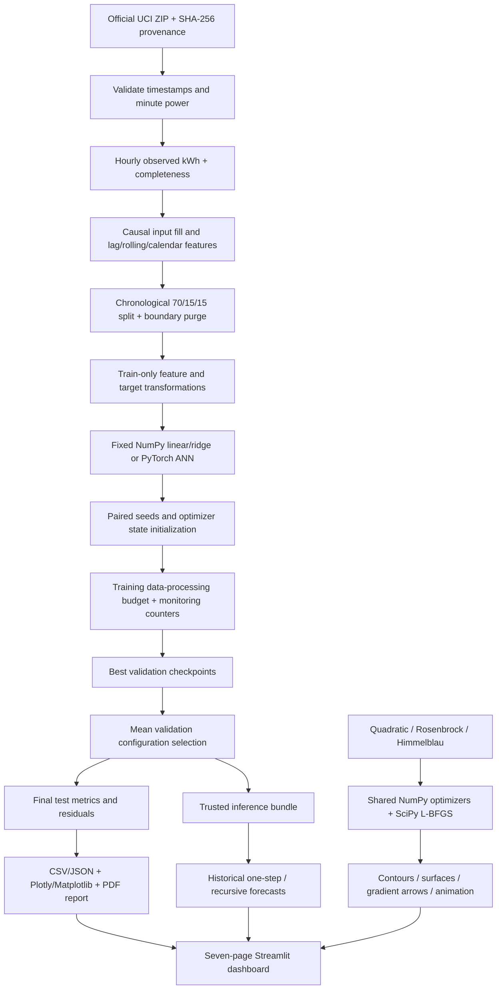

# Project architecture

The training module never reads test arrays. The experiment runner owns final selection and test evaluation. Inference bundles contain the fitted transformations, model parameters, configuration, and training-period metadata; they do not embed the full dataset. The recursive prediction module truncates history at the origin before computing any features.
